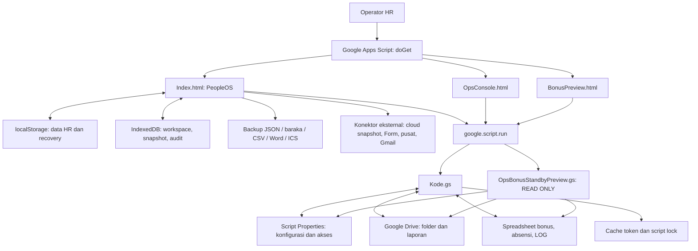

# Audit repository BARAKA PeopleOS OPS 2026

Tanggal audit: 6 November 2026. Commit acuan: `52c674009f3bb000d83df38a968613ba47d46b32` pada checkout `main`.

Audit ini membaca struktur, implementasi, dokumentasi, manifest, dan pengujian repository. Tidak ada kode aplikasi, pengujian, konfigurasi deployment, atau data perusahaan yang diubah. Dokumen ini adalah tambahan dokumentasi.

## 1. Kesimpulan dan batas pembuktian

BARAKA PeopleOS adalah aplikasi HR dan operasional berbasis JavaScript browser dengan backend Google Apps Script. Data HR utama dikelola di browser; integrasi operasional membaca laporan dari Google Drive dan menulis ke Google Spreadsheet melalui Apps Script. Spreadsheet bukan database otomatis untuk seluruh modul HR.

Terdapat tiga kelompok integrasi yang harus dibedakan:

1. **Backend OPS yang benar-benar ada di repository:** `Kode.gs`, melayani halaman, konfigurasi cabang, folder upload, scan, preview, commit Datot/absensi, dan audit.
2. **Preview bonus khusus Pontianak Barat:** `OpsBonusStandbyPreview.gs` dan `BonusPreview.html`, hanya membaca dan menghasilkan rencana. Tidak memiliki endpoint commit.
3. **Konektor HR/cloud tambahan di frontend:** cloud snapshot, Google Form, database pusat, Gmail, Calendar, dan file Vault OneDrive. Sebagian memerlukan layanan/deployment terpisah atau contoh kode yang ditampilkan UI; bukan seluruhnya endpoint yang tersedia dalam `Kode.gs`.

Status dalam laporan:

| Status | Arti |
| --- | --- |
| Teruji lokal | Perilaku benar-benar dijalankan dalam pengujian lokal saat audit |
| Terimplementasi | Handler/logika ditemukan di kode; belum membuktikan seluruh alur browser atau produksi |
| Bersyarat | Bergantung pada browser, konfigurasi, izin Google, file, atau backend eksternal |
| Belum tersedia | Komponen yang diperlukan tidak ditemukan di checkout ini |

**Hasil yang terbukti:** 42 pengujian lokal lulus, 0 gagal, 0 dilewati. Dua file `.gs`, 28 blok JavaScript inline `Index.html`, serta masing-masing satu blok pada `OpsConsole.html` dan `BonusPreview.html` berhasil dikompilasi secara sintaksis. Kompilasi bukan pengujian runtime browser.

Tidak dilakukan login Google, akses spreadsheet perusahaan, pengiriman email/WA, push cloud, perubahan Script Properties, atau deployment. Dengan demikian, laporan ini tidak menyatakan semua fitur sudah berjalan di produksi. Empat resi perusahaan juga belum diverifikasi; suite memakai data sintetis.

## 2. Struktur lengkap checkout

Tidak ditemukan `AGENTS.md`, package manifest, lockfile dependency, workflow CI, konfigurasi clasp, atau framework build dalam daftar file proyek. Tidak ada instalasi npm yang diperlukan untuk suite yang tersedia. Node.js yang digunakan saat audit: `v24.22.1`.

```text
BARAKA-PeopleOS-OPS-2026/
├── README.md
├── Index.html
├── Kode.gs
├── OpsConsole.html
├── OpsBonusStandbyPreview.gs
├── BonusPreview.html
├── appsscript.json
├── docs/
│   ├── bonus-preview-audit.md
│   └── audit-repository-2026-11-06.md   ← hasil audit ini
└── tests/
    └── bonus-preview.test.cjs
```

Direktori `.git` menyimpan metadata versi, bukan bagian runtime aplikasi.

| File | Fungsi dan tanggung jawab | Hubungan utama |
| --- | --- | --- |
| `README.md` | Identitas proyek dan deskripsi singkat integrasi OPS/bonus | Belum menjadi panduan instalasi/deployment lengkap |
| `Index.html` | SPA tanpa framework: CSS, engine HR, data demo, validasi, local storage, UI, dokumen, komunikasi, backup, konektor, dan parser OPS | Memanggil backend OPS lewat `google.script.run`; konektor lain memakai URL eksternal, unduhan, atau link browser |
| `Kode.gs` | Backend Apps Script bersama: routing HTML, akses, konfigurasi, folder Drive, parser, inspeksi target, commit, dan log | Menggunakan `HtmlService`, `DriveApp`, `SpreadsheetApp`, `PropertiesService`, `CacheService`, `LockService`, `Utilities`, `XmlService`, dan `Session` |
| `OpsConsole.html` | Halaman pemeriksaan koneksi dan daftar konfigurasi cabang | Memanggil `getOpsBootstrap`; bukan panel sinkronisasi penuh |
| `OpsBonusStandbyPreview.gs` | Backend preview khusus `014PTK`, parser Datot ketat, inspeksi pasangan baris/merge/formula, rencana dan diagnostik | Menggunakan `assertAuthorized_` dan `loadConfig_` dari `Kode.gs`; membaca Drive dan Sheets |
| `BonusPreview.html` | UI input tanggal/folder/workbook/file, ringkasan, konflik, rencana B:P dan Q:R, informasi dan diagnostik | Bootstrap konfigurasi, lalu `previewBonusStandbyPontianakBarat`; tidak menyediakan tombol impor |
| `appsscript.json` | Runtime V8, zona waktu, scope OAuth, dan pengaturan web app | `Asia/Jakarta`, scope Drive/Sheets/email identitas, `USER_DEPLOYING`, akses `MYSELF` |
| `docs/bonus-preview-audit.md` | Kebijakan preview, mapping, alasan perubahan, batas bukti dan prosedur retest di Apps Script | Referensi bisnis dan pengujian preview; bukan bukti deployment produksi |
| `tests/bonus-preview.test.cjs` | Suite Node built-in `node:test`, assertion, VM, mock Sheets/Drive/DOM | Memuat backend preview, sebagian alur bersama `Kode.gs`, dan script UI `BonusPreview.html` |

`Baraka_OneDrive_Sync_Vault.js` dirujuk frontend tetapi **tidak ada** dalam checkout. Aplikasi menyediakan mekanisme menghasilkan file tersebut. Ini artefak data opsional, bukan dependency npm.

## 3. Arsitektur aplikasi



### 3.1 Frontend

`Index.html` berisi sekitar 12 ribu baris dalam satu file. Engine awal mengekspor objek global `HR` berisi aturan bisnis dan helper. UI menggunakan fungsi render, string HTML, modal, atribut `data-action`, dan event delegation. State aktif antara lain `db`, `route`, cabang, periode, pencarian, draft dokumen, dan draft pesan.

Kode berkembang melalui paket tambahan 6.3, 7.6, 8.x, 9.x, sampai 10.9. Paket ini membungkus/mengganti fungsi global seperti `render`, `persist`, `cloudOperation`, `letterHTML`, `buildMessage`, dan generator exit clearance. Perilaku akhir harus ditelusuri mengikuti urutan script; membaca fungsi awal saja tidak cukup. Contoh: implementasi `cloudOperation` terakhir berada sekitar baris 7545, sedangkan panel cloud OPS memiliki jalur RPC tersendiri sekitar baris 11789.

Versi antarmuka dan versi skema berbeda: label paket terakhir 10.9, sementara wrapper kompatibilitas menetapkan `HR.VERSION` dan `schemaVersion` ke 9.0. Label versi tidak membuktikan migrasi data terkontrol.

### 3.2 Penyimpanan dan model data

| Lapisan | Isi/peran | Batas penting |
| --- | --- | --- |
| `localStorage` | Database JSON utama `baraka_peopleos_v4`, demo terpisah, recovery, preferensi dan konfigurasi tambahan | Terikat browser/origin; bukan database multiuser; tidak otomatis terenkripsi |
| IndexedDB | `BarakaPeopleOS_IndexedDB_v9`: `workspaces`, `snapshots`, `audit_logs` | Snapshot asinkron; beberapa error ditelan; bukan bukti sinkronisasi server |
| Backup unduhan | JSON ber-checksum SHA-256; `.baraka` terenkripsi AES-GCM | Checksum membuktikan konsistensi isi, bukan identitas pengirim |
| Script Properties | Konfigurasi integrasi OPS dan daftar email yang diizinkan | Berada di proyek Google Apps Script, terpisah dari setting browser |
| Drive/Sheets | File sumber, workbook cabang, log integrasi | Bergantung izin akun deployment dan resource yang dikonfigurasi |

Koleksi inti: `employees`, `candidates`, `tasks`, `attendance`, `leaves`, `claims`, `assets`, `cases`, `reviews`, `documents`, `messages`, `payroll`, `activity`, `evidence`. Tambahan mencakup metadata kalender, arsip eks-karyawan, dan ekstensi setting.

Relasi memakai ID: `empId` untuk data karyawan, `candidateId`/`employeeId` untuk konversi kandidat, serta ID cabang. Arsip surat menyimpan snapshot perusahaan/karyawan. Payroll memakai pasangan karyawan/periode. Tidak ada ORM atau database SQL.

Enam cabang bawaan: Pontianak Barat, Pontianak Timur, Port Pontianak, Mempawah, Singkawang, Sambas. Nama, alamat, posisi, hari kerja, kuota cuti, tarif potongan, dan checklist dapat diatur. Filter cabang adalah fitur tampilan, bukan pembatasan akses server per cabang.

### 3.3 Backend dan routing

`doGet(e)` pada `Kode.gs:29` melakukan pemeriksaan akses lalu memilih:

| Parameter URL | Halaman |
| --- | --- |
| Tanpa parameter khusus | `Index.html` |
| `?ops=1` | `OpsConsole.html` |
| `?bonus=1` | `BonusPreview.html` |
| `?diagnostik=1` | HTML diagnostik sederhana |

Manifest menetapkan eksekusi sebagai pengguna yang melakukan deployment dan akses `MYSELF`. Kondisi deployment aktual tidak dapat disimpulkan hanya dari manifest. `BARAKA_ALLOWED_EMAILS` menambah allowlist server; bila kosong, `assertAuthorized_` membolehkan proses dan mengandalkan pembatasan deployment. Tidak ada RBAC server untuk membedakan admin, pembaca, atau operator cabang.

## 4. Inventaris fitur yang terimplementasi

Kecuali ditandai teruji, fitur berikut ditemukan melalui inspeksi implementasi, belum diuji end-to-end dengan browser/akun perusahaan.

| Modul | Kemampuan yang ada | Ketergantungan/batas |
| --- | --- | --- |
| Dashboard | Statistik staf/cabang, grafik kehadiran, agenda, radar kontrak/SIM, prioritas tugas/cuti/klaim/kasus/aset, execution center | Menggunakan data HR browser |
| Karyawan | Input/edit/profil, cabang/jabatan/status, kontrak dan SIM, checklist dokumen, impor CSV dan ekspor, filter kategori | Identitas lokal; belum database SDM bersama otomatis |
| Rekrutmen | Pipeline/kanban, drag/drop tahap, interview/psikotes/offering, kontak WA, CV, konversi kandidat menjadi karyawan | Konversi membuat tugas onboarding dan mencegah relasi kandidat ganda |
| Talent pool | Hold kandidat tunggal/massal, simpan tahap sebelumnya, aktifkan kembali, sembunyikan kandidat hold dari agenda | Tidak menghapus data kandidat |
| Riwayat eks-Baraka | Arsip dan pencocokan kandidat dengan riwayat nama/telepon, badge/peringatan | Pencocokan heuristik, bukan verifikasi identitas resmi |
| Tugas/workflow | Tugas, PIC, prioritas, tenggat, checklist onboarding/offboarding, pengulangan dan eskalasi, workflow cards | Berjalan saat aplikasi digunakan; bukan worker server terjadwal |
| Absensi HR lokal | Kehadiran, masuk/pulang, durasi lintas tengah malam, terlambat dan lembur, ringkasan bulanan | Koleksi lokal terpisah dari workbook absensi OPS |
| Cuti/izin | Hitung hari kerja/libur, saldo tahunan, validasi benturan, keputusan setuju/tolak dan catatan | Keputusan lokal, bukan approval terautentikasi server |
| Payroll | Generate per karyawan/periode, gaji+tunjangan+bonus+lembur, potongan terlambat/alfa, pajak/BPJS input, THP, status dan slip | Tidak terlihat kalkulasi pajak/BPJS regulatif lengkap atau transfer bank |
| Klaim/benefit | Pencatatan nominal/kategori/bukti, status dan keputusan | Tidak mengirim pembayaran |
| Hubungan karyawan | Kasus/pembinaan, tindak lanjut, BA/SP dan pengingat | Alur administrasi lokal |
| Aset/GA | Inventaris, pemegang, cabang, kondisi, pinjaman/perbaikan dan pengembalian | Dipakai juga dalam exit clearance |
| Pengembangan | Pelatihan/evaluasi/skor, agenda, tautan Form/Sheet dan input evaluasi tempel | Backend evaluasi eksternal tidak lengkap dalam checkout |
| Kalender | Agenda dari beberapa modul, status/reschedule, ekspor ICS, link Google Calendar dengan durasi | Membuka formulir Calendar; tidak membuktikan acara tersimpan melalui API |
| Dokumen/surat | Template surat, SP, surat tugas, PKWT, BA subsidi sopir luar kota, exit clearance, nomor surat, arsip/revisi, cetak/PDF browser dan ekspor HTML/Word | Word berupa ekspor HTML `.doc`, bukan generator OOXML `.docx`; status lokal bukan tanda tangan digital |
| Tanda tangan/kop | Logo dan gambar tertanam, stempel, crop serta pengaturan ukuran/posisi tanda tangan, tata letak A4 | Gambar tanda tangan bukan bukti persetujuan terautentikasi |
| Komunikasi WA | Template rekrutmen/meeting/pengumuman, salam/jam, peserta, preview, salin, arsip, buka `wa.me`, batch | Tidak ada bukti pengiriman/penerimaan melalui WhatsApp Business API |
| Gmail cabang | Buku alamat cabang/CC, compose Gmail, salin surat rich text, permintaan kirim background | Pengiriman background memerlukan handler MailApp eksternal; tidak ada dalam `Kode.gs` |
| Form pelamar | Pengaturan sheet/form, pull, pemetaan data kandidat/CV/psikotes, deduplikasi dan filter cabang | Memerlukan endpoint pembaca terpisah yang sesuai kontrak respons |
| Database pusat | Pull/merge data karyawan dari URL read-only, mapping dan ringkasan | Endpoint pusat tidak tersedia di backend OPS repository |
| SOP/alat taktis | Generator SOP, triage, command cepat, broadcast, daftar sopir luar kota | Logika/artefak lokal; bukan sistem AI atau layanan pengiriman otomatis |
| Laporan | Ringkasan HR, ekspor CSV, salin/cetak laporan, statistik per periode/cabang | Kelengkapan mengikuti data lokal |
| Backup/pemulihan | JSON, SHA-256, AES-GCM/PBKDF2, recovery, preview impor dan sandbox restore, lifecycle backup | Retensi terjadwal tertentu hanya menyimpan ringkasan; lihat temuan |
| Cloud/Vault | Push/pull snapshot, JSONP/fetch, fallback lokal dan file Vault untuk folder OneDrive | Bukan integrasi Microsoft Graph; butuh file/endpoint eksternal |
| UI dan privasi | Demo/kerja, dark mode, pencarian, dock terpadu, minimisasi kartu, filter global, bulk actions, masking tampilan, last-work state | Masking tampilan tidak mengenkripsi penyimpanan |
| Audit lokal | Riwayat aksi/perubahan tersamarkan, failed audit, ekspor dan panel self-test | Identitas/hash lokal tidak membuat audit tahan manipulasi |
| OPS lokal | Upload Datot HTML `.xls`/HTML dan absensi `.xlsx`, parse, mapping cabang, validasi, preview/coverage | Tidak menulis hasil uploader lokal ke Sheets; state sesi OPS terpisah |
| OPS Drive/Sheets | Konfigurasi, folder, tes akses, scan, preview token, commit Datot/absensi dan LOG | Terimplementasi di backend; penulisan live tidak dijalankan saat audit |
| Preview bonus 014PTK | Pembacaan pasangan baris/merge, rencana B:P dan Q:R, konflik, perlindungan formula, diagnostik | **Teruji lokal, READ ONLY, belum memiliki commit** |

## 5. Kontrak frontend–backend OPS

Panel `opsIntegration` memanggil `opsServerCall(method, ...args)` yang membungkus `google.script.run` dalam Promise. Error server diteruskan ke UI. Saat dibuka sebagai file HTML biasa, bridge Google ini tidak tersedia; UI menjelaskan mode lokal.

| Fungsi publik | Pemanggil/peran | Efek |
| --- | --- | --- |
| `getOpsBootstrap()` | Ketiga halaman: konfigurasi publik, akun, mapping dan URL audit | Baca |
| `saveOpsConfig(payload)` | Panel OPS utama | Tulis Script Properties, naikkan versi konfigurasi |
| `setupOpsUploadFolders()` | Panel OPS | Buat/temukan folder upload, simpan ID dan versi |
| `createOpsDateFolders(dateISO)` | Panel OPS | Buat/temukan folder tanggal |
| `testOpsConfig(dateISO)` | Panel OPS | Baca akses folder/workbook/tab |
| `scanOpsDrive(dateISO)` | Panel OPS | Baca folder dan validasi sumber; tanpa inspeksi penuh target |
| `previewOpsSync(dateISO)` | Panel OPS | Baca sumber/target, simpan token preview di CacheService |
| `commitOpsSync(dateISO, previewToken)` | Panel OPS sesudah konfirmasi | Tulis workbook yang siap, audit, konsumsi token |
| `previewBonusStandbyPontianakBarat(payload)` | Halaman bonus khusus | Baca sumber/target dan mapping, kembalikan rencana/diagnostik |

Helper privat memakai akhiran `_`. Dua utilitas `cekSumberPontianakBarat` dan `daftarTabBonusPontianakBarat` menyimpan ID resource spesifik di kode dan membaca metadata lewat logger. Keduanya tidak terlihat dipanggil dari UI dan tidak memanggil `assertAuthorized_` secara eksplisit. ID resource tidak disalin ke dokumen ini.

## 6. Integrasi Google Drive dan Spreadsheet

### 6.1 Konfigurasi dan folder

`BARAKA_OPS_CONFIG_V2` menyimpan versi, cabang, `branchFolderId`, `uploadFolderId`, `bonusSpreadsheetId`, `attendanceSpreadsheetId`, `opsCodes`, audit workbook dan mapping tujuan. Mapping default: `010SBY=SURABAYA BARAT`. `BARAKA_OPS_AUDIT_SPREADSHEET_ID` menyimpan workbook LOG; `BARAKA_ALLOWED_EMAILS` menyimpan daftar akses.

```text
Folder induk cabang/
└── UPLOAD OPERASIONAL/
    └── YYYY-MM-DD/
        ├── satu file Datot .xls / .html / .htm
        └── satu file absensi .xlsx
```

Folder tanggal atau file sejenis ganda diblokir. Scan membatasi 20 file per folder cabang. Kode cabang, periode, record dan mapping tujuan divalidasi. Tab tujuan dipilih berdasarkan nomor hari: `2026-11-02` → tab `2`, bukan tab rekap `BONUS`.

### 6.2 Alur scan–preview–commit lama

1. Scan folder cabang, kelompokkan Datot dan absensi, baca metadata sumber.
2. Parse dan validasi tanggal, kode cabang, struktur, duplikasi dan mapping.
3. Preview membaca target, menghitung baru/identik/konflik dan membuat token UUID.
4. Cache menyimpan tanggal, fingerprint, versi konfigurasi, waktu dan email pengguna; TTL yang diminta 21.600 detik. Cache dapat hilang lebih awal.
5. Commit memeriksa token/tanggal/akun, mengambil script lock, membaca ulang konfigurasi dan scan.
6. Fingerprint dibandingkan; kemudian hanya item berstatus siap yang diproses. Tiap jenis/cabang dapat berhasil atau gagal secara terpisah.
7. Hasil ditulis ke LOG; kegagalan log dikembalikan sebagai `auditWarning`. Token dihapus setelah jalur pemrosesan selesai, lock dilepas.

Fingerprint berasal dari tanggal, versi konfigurasi, ID folder serta ID/ukuran/waktu modifikasi file dan kondisi error, kemudian di-hash SHA-256. Ini bukan hash menyeluruh isi workbook tujuan atau transaksi lintas spreadsheet.

### 6.3 Datot → bonus

Sumber `.xls` yang didukung sebenarnya **tabel HTML**, bukan binary Excel `.xls`. Parser membaca identitas laporan, periode, resi dan 18 kolom.

| Kolom | Isi |
| --- | --- |
| A | Nomor urut |
| B–C | Tanggal masuk dan berangkat |
| D–G | Pengirim, nomor resi, penerima, tujuan |
| H–J | Koli, Kg, M3 |
| K–N | Tunai, bayar tujuan, VA pengirim, VA tujuan |
| O–P | Via dan OT |
| Q–R | Status dan kode cabang |
| S–Z | Area formula workbook di luar data sumber |

**Jalur lama** (`Kode.gs:701`, `845`): memeriksa resi dari E, membandingkan satu baris A:R, melewati baris identik dan menolak konflik. Resi baru ditambahkan sebagai satu baris A:R sesudah data terakhir. Fungsi `copyBonusFormulaTemplate_` dapat mengisi formula S:Z pada baris baru dari template sebelumnya bila tidak menemukan formula pada rentang baris tersebut. Jadi pernyataan bahwa seluruh jalur aplikasi tidak pernah menyentuh S:Z tidak akurat.

**Jalur preview baru** (`OpsBonusStandbyPreview.gs`): memakai pasangan 5/6, 7/8 dan seterusnya. E berada di baris atas, field lain umumnya bawah, dengan resolusi anchor merge aktual. A dipertahankan; resi lama tidak mempunyai rencana penggantian B:P. Tanggal berangkat yang berbeda menjadi informasi; Q:R memiliki rencana terpisah. Tidak ada penulisan, pengubahan merge/format, atau penyalinan formula.

Aturan preview baru:

- Cabang wajib `014PTK`; tanggal header dan setiap resi harus sesuai, kode baris konsisten dengan header.
- Baca mapping tujuan tersimpan; pembandingan tidak menebak kesamaan kode dan nama.
- Slot baru mensyaratkan B:P kedua baris kosong tanpa formula; Q:R lama tidak menentukan keterisian slot.
- Nol, whitespace, orphan data dan formula yang tampil kosong tetap melindungi slot.
- Identitas ganda/berformula, formula Q:R, merge horizontal/lintas pasangan diblokir sesuai aturan.
- Format angka lokal, Date, serial Sheets, NBSP, status dua baris, dan nilai mentah/tampilan dibedakan.
- Jika ada tab `BONUS`, nama bulan yang dikenali pada B2 dicek; ini belum validasi tahun workbook.
- Batas file 5 MiB, 1.500 slot; daftar respons dibatasi 80 entri, ringkasan memakai hasil penuh.
- Input URL file langsung dapat melewati pencarian folder tanggal; tidak membuktikan file berasal dari folder cabang yang diisi.

**Implikasi:** hasil preview baru tidak boleh dianggap rencana yang otomatis akan dijalankan `commitOpsSync`. Keduanya menggunakan mesin inspeksi dan tata letak berbeda.

### 6.4 XLSX → absensi

Backend membuka ZIP XLSX dengan `Utilities.unzip`, membaca XML workbook/relationships/shared strings dan worksheet pertama. Header wajib: NIB, Nama, Absen Masuk/Masuk, Absen Keluar/Keluar. Tanggal/jam dinormalisasi dari serial Excel atau teks.

Target mulai baris 4:

| Kolom target | Isi |
| --- | --- |
| B / C / D | NIB datang / nama / jam datang |
| F / G / H | NIB pulang / nama / jam pulang |

Identitas B:C dan F:G dibuat sama walaupun salah satu jam kosong. NIB/nama atau jam yang berbeda dari data lama menjadi konflik; sel kosong dapat dilengkapi. Formula pada sel patch diperiksa sebelum patch dijalankan. Record baru ditambahkan setelah data absensi terakhir. Kolom di luar dua rentang tersebut tidak ditulis oleh fungsi commit absensi.

Validasi menerima tepat satu tanggal laporan; data shift dengan masuk/pulang pada tanggal berbeda berpotensi tertahan oleh aturan ini. Parser lokal browser menggunakan ZIP reader sendiri, `DOMParser`, dan `DecompressionStream('deflate-raw')`; ZIP64 dan XLSX berpassword ditolak.

Tidak terlihat jalur yang otomatis memasukkan hasil commit workbook absensi ke koleksi `db.attendance` PeopleOS. Karena itu angka payroll lokal tidak otomatis berubah sesudah sinkronisasi OPS Sheets.

### 6.5 Audit integrasi

`ensureAuditSheet_` membuat/membuka workbook audit dan tab `LOG`. Kolom: waktu, tanggal OPS, ID/nama cabang, jenis data, status, ditambahkan, dilewati, dilengkapi, rincian. Ini terpisah dari log aktivitas browser. Audit bukan transaksi atomik bersama perubahan workbook; data dapat berhasil ditulis saat log gagal.

## 7. Konektor eksternal: yang tersedia dan yang belum

| Integrasi | Implementasi yang ditemukan | Yang belum dibuktikan/tersedia |
| --- | --- | --- |
| Cloud snapshot HR | Push/pull browser, fallback JSONP/fetch, contoh `UNIVERSAL_GAS_CODE` | Tidak ada `doPost` aktif dalam file `.gs` repository untuk kontrak ini |
| Universal GAS | String template di `Index.html:7389` berisi `doGet`/`doPost`, Script Properties dan fallback Drive | Tidak otomatis dieksekusi oleh backend proyek ini; perlu proyek/deployment terpisah |
| Google Form/pusat | UI URL/sheet/folder, fetch dan logika merge kandidat/karyawan | Backend pembaca data terkait tidak ditemukan di `Kode.gs` |
| OneDrive | Generate/load file JavaScript Vault di folder lokal | Tidak ada OAuth Microsoft/Graph atau bukti sync OneDrive selesai |
| Gmail background | Frontend POST `send_branch_email`; snippet `MailApp.sendEmail` dalam modal | Handler aktif dan scope Gmail/MailApp tidak ada dalam backend/manifest saat ini |
| WhatsApp | Deep link `wa.me` dan template | Tidak ada API pengiriman atau delivery receipt |
| Calendar | Template URL dan file ICS, status agenda lokal | Tidak ada backend Calendar API untuk konfirmasi acara |

URL deployment cloud bawaan ada di setting frontend, tetapi bukan bukti layanan masih aktif, dimiliki pengguna yang benar, atau cocok dengan kontrak yang diharapkan. Tidak dilakukan panggilan ke URL tersebut dalam audit.

## 8. Temuan risiko dan utang teknis

Prioritas di bawah adalah rekomendasi pengembangan, bukan perubahan yang sudah diterapkan.

| ID / prioritas | Bukti | Dampak dan tindak lanjut |
| --- | --- | --- |
| A01 / tinggi | `Index.html:7545–7594`: push memakai `no-cors`, menetapkan `gasOk` setelah fetch, lalu selalu `cloudMarkConfirmed`, termasuk saat hanya fallback lokal | Status “Berhasil” tidak membuktikan server menyimpan data. Pisahkan status lokal, terkirim, dan terkonfirmasi; validasi receipt server dan read-back |
| A02 / tinggi | `Index.html:7664–7670`: pull menghapus `backupIntegrity`, memvalidasi skema lalu memanggil `previewImport(validated, true)` | Checksum sumber tidak diverifikasi pada jalur terakhir; label verified terlalu kuat. Gunakan unpack/verifikasi sebelum menampilkan status tersebut |
| A03 / tinggi | `Kode.gs:701`, `845` dibanding `OpsBonusStandbyPreview.gs:358` | Commit lama satu baris berbeda dari preview pasangan baris. Jangan menghubungkan tombol commit lama ke hasil preview baru; perlu mesin plan/apply yang konsisten dan uji workbook salinan |
| A04 / tinggi | `Index.html:6004–6032`: sesi default memiliki `verified: true` dan `PIN-Session` dari data lokal | Tidak ada pembuktian autentikasi server pada jalur ini. Identitas audit dapat berasal dari browser; perlukan identitas Google/RBAC server dan log yang tidak dapat diedit klien |
| A05 / tinggi, bersyarat deployment | Contoh GAS `Index.html:7389–7490` menganjurkan akses Anyone dan tidak memuat pemeriksaan autentikasi pada doGet/doPost | Jika contoh dipasang demikian, data HR snapshot berpotensi dibaca/ditulis pihak yang mengakses endpoint. Review autentikasi sebelum deployment; contoh ini bukan backend aktif yang sudah diaudit live |
| A06 / sedang | `Index.html:7442–7480`: contoh cloud menyimpan satu property bila panjang serialized <400.000 | Tidak sesuai batas Apps Script per nilai property (9 KB); snapshot jauh lebih kecil dari 400 KB pun dapat gagal. Gunakan penyimpanan yang sesuai dan uji batas byte/kuota |
| A07 / sedang | `Kode.gs:344–413`, `239–285`: fingerprint metadata sumber, lock Apps Script, commit per file | Tidak ada transaksi lintas workbook, lock tidak mencegah edit manual Sheets, hasil bisa parsial. Tambahkan ID run, rekonsiliasi, retry idempoten dan pemeriksaan target menjelang apply |
| A08 / sedang | `Kode.gs:758–777`, `845–865` | Commit Datot dapat menulis A:R dan formula S:Z; perlindungan formula/merge tidak sama dengan preview baru. Dokumentasikan rentang tulis dan tambah preflight target menyeluruh |
| A09 / sedang | `Index.html:9552–9594` | Gmail background menampilkan perintah terkirim sesudah POST opaque; tidak membuktikan email terkirim. Handler dan scope server belum tersedia dalam proyek ini |
| A10 / sedang | `Index.html:6921–6942`, `5928–5946` | “Scheduled backup” menyimpan ringkasan hitungan, bukan payload pemulihan; snapshot IndexedDB bertambah tanpa retensi eksplisit dalam fungsi simpan. Bedakan ringkasan dan backup penuh, tambah retensi serta restore drill |
| A11 / sedang | `Index.html:8883–8918` | Wrapper memaksa schemaVersion ke 9.0, memutasi input, dan dapat membersihkan loadError pada catch. Risiko kehilangan sinyal incompatibility; perlukan migrasi versi bertahap dan error yang tetap terlihat |
| A12 / sedang | `Index.html:9774–9805` dibanding `580–609` | Update alamat menulis localStorage langsung, sementara core memakai `loadedRaw`, recovery dan revision guard. Potensi ketidaksinkronan state/konflik semu perlu direproduksi dengan data lama |
| A13 / sedang | `Index.html:7381`, `7497–7539`, `7599–7618` | Vault dan JSONP dimuat sebagai script, sehingga sumber tersebut dapat mengeksekusi kode di halaman. Beralih ke data JSON terverifikasi dan endpoint terautentikasi |
| A14 / sedang | Uploader browser 15 MiB, preview khusus 5 MiB; parser server absensi memakai unzip dan XML | Batas tidak konsisten; tidak terlihat pembatasan total ukuran hasil dekompresi pada parser ZIP lokal. Tambahkan budget byte/entry/record dan uji file besar/rusak |
| A15 / sedang | `Kode.gs:287–293`, `1004`, `1047` | Allowlist kosong mengandalkan deployment; dua utilitas publik tidak memakai guard eksplisit. Terapkan kontrol konsisten dan uji akses anonim/tidak berizin |
| A16 / sedang | `Index.html` berisi 28 blok script, banyak wrapper global; suite hanya khusus bonus | Risiko regresi lintas modul dan urutan override tinggi. Modularisasi bertahap, tetapkan versi rilis/skema, tambah CI dan smoke test browser |

Tambahan keterbatasan domain: workbook tab harian tidak membawa bulan/tahun dalam nama tab; preview baru hanya memeriksa nama bulan yang dikenali, backend lama tidak memverifikasi periode workbook secara lengkap. Nominal pajak/BPJS adalah input payroll, bukan bukti kepatuhan perhitungan. Preview langsung memakai file URL tidak memvalidasi keanggotaan folder. Scope Drive/Sheets tetap luas karena backend lama dapat menulis.

## 9. Validasi saat audit

Perintah dari akar repository:

```sh
node tests/bonus-preview.test.cjs
```

Hasil: **42 passed, 0 failed, 0 skipped**, menggunakan Node.js 24.22.1. Cakupan aktual meliputi:

- Parser Datot, kolom/header/nomor resi, periode, format angka/tanggal dan mapping.
- Empat resi sintetis, merge/unmerged campuran dan anchor setiap field.
- Nol tersembunyi, whitespace, nilai kosong, serial Sheets dan zona waktu Date.
- Resi ganda, formula identitas/B:P/Q:R, orphan data, merge tidak didukung dan batas scan.
- Reset penuh/parsial, reuse slot awal, perlindungan resi lama, rencana Q:R dan preview berulang tanpa mutasi mock.
- Endpoint melalui backend bersama/config mock, serialisasi diagnostik, dan renderer `BonusPreview` yang memakai textContent untuk nilai tak tepercaya.

Pemeriksaan sintaks memakai `vm.Script` untuk seluruh script inline ketiga halaman dan kedua file `.gs`; seluruhnya lulus. Satu referensi script eksternal Vault tidak dikompilasi karena file tidak tersedia. Tidak menjalankan string contoh GAS sebagai deployment.

Belum diuji: UI PeopleOS lengkap di browser, DOM/event antar upgrade pack, penyimpanan dan recovery nyata, IndexedDB/migrasi, kriptografi end-to-end UI, commit lama, parser absensi terhadap XLSX perusahaan, multiuser, akses Google, email, Form, cloud snapshot, dan performa workbook besar. Panel self-test bawaan bukan pengganti pengujian ini dan tidak dijalankan sebagai bagian suite 42 tes.

## 10. Potensi pengembangan dan urutan rekomendasi

| Tahap | Hasil yang dituju | Kriteria penerimaan |
| --- | --- | --- |
| 1. Kejelasan integrasi | Pisahkan kontrak OPS, preview bonus dan cloud HR; perbaiki status koneksi/pengiriman | Server error/offline tidak menghasilkan klaim sync atau email berhasil; dokumentasi tiap endpoint tersedia |
| 2. Identitas dan audit | Login Google/RBAC server, pembatasan cabang, bukti operator dan audit server | Akun tak berizin ditolak server, pemalsuan role browser tidak memberi hak tambahan |
| 3. Bonus aman | Satu mesin rencana dan eksekusi sesuai template pasangan baris | Dry-run dan apply cocok per alamat; formula/merge/A/S:Z terlindungi sesuai kebijakan; uji salinan dan persetujuan terpisah sebelum live |
| 4. Ketahanan data | Penyimpanan cloud sesuai kuota, migrasi versioned, checksum asli dan backup penuh dengan retensi | Restore diuji dari file backup, bukan hanya hitungan; data corrupt/migrasi gagal tetap dapat dipulihkan |
| 5. Pengujian & rilis | Modul frontend terpisah, build yang tetap kompatibel HtmlService, CI Node dan browser | Smoke test semua rute; uji akhir override, import/export, payroll, dokumen dan absensi; rilis/skema konsisten |
| 6. Otomatisasi terukur | Antrian integrasi dengan run ID, retry idempoten, rekonsiliasi per cabang dan monitoring | Pemrosesan parsial dapat dilanjutkan tanpa duplikasi; ada laporan error dan histori job |
| 7. Penyatuan HR–OPS | Pemetaan NIB↔employee ID dan impor attendance Sheets ke HR melalui preview | Selisih sumber ditampilkan, identitas ambigu diblokir, payroll lokal diperbarui hanya setelah persetujuan |
| 8. Ekspansi bisnis | Preview bonus lintas cabang, laporan lintas periode, dashboard kualitas data, approval dokumen | Konfigurasi template/cabang eksplisit, fixture tiap variasi dan bukti hasil pada salinan workbook |

Peluang produk tambahan: portal karyawan dengan akses terbatas, pengajuan cuti/klaim terpusat, notifikasi kontrak/SIM melalui kanal resmi, approval multi-level, lampiran dengan kontrol akses, payroll yang memakai aturan terkonfigurasi, `.docx` native, serta integrasi Calendar/Gmail resmi dengan receipt. Semuanya masih usulan, bukan fitur baru yang diaktifkan oleh audit ini.

## 11. Panduan tindak lanjut tanpa mengubah aplikasi

Untuk review berikutnya, gunakan checkout yang ada dan jalankan suite Node dari akar repository. Untuk pembuktian live, siapkan proyek Apps Script pengujian yang terotorisasi, salinan workbook dengan template/merge/formula representatif, contoh Datot/XLSX yang disamarkan, dan akun dengan akses yang sesuai. Ikuti prosedur `docs/bonus-preview-audit.md`; jangan memakai tombol commit lama untuk membuktikan preview baru. Audit ini tidak memerlukan kredensial dalam chat dan tidak mengaktifkan penulisan ke spreadsheet.

Tidak dilakukan commit Git, push, penghapusan file, atau publikasi. Perubahan repository yang diharapkan hanya penambahan dokumen audit ini.
